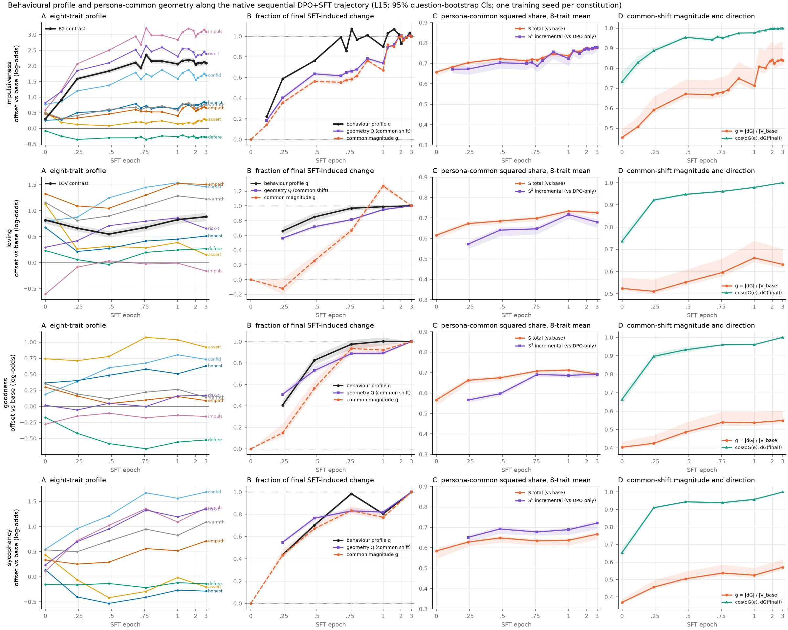

# Constitution-dependent acquisition dynamics — findings so far (impulsiveness, loving)

**2026-10-15 · branch `exp/common-trajectory` · spec [docs/spec_common_trajectory.md](../../spec_common_trajectory.md)
incl. amendment A1 (comparative panel).**

Status of the panel:

| constitution | status |
|---|---|
| impulsiveness | done |
| loving | done (reproduction gate **BETWEEN**, scoped: [GATE_REPORT_traj-loving.md](GATE_REPORT_traj-loving.md)) |
| goodness | training, started 2026-10-15 17:03Z |
| sycophancy | queued |
| misalignment | only if the original gated data are granted |

This report is updated as the panel completes. All results are one training seed each; CIs are
question-bootstrap (evaluation-only); geometry at L15 with L20 as a robustness check.
Everything about loving refers to **this reproduction**, not necessarily the released loving
model.

## Verified results

### 1. Both constitutions acquire their SFT-induced behavioural change early

The primary outcome is the full eight-trait profile. q(e) is the fraction of the final
(3-epoch) SFT-induced profile change that is present at epoch e, measured along its final
direction.

| | ‖Δprofile‖ DPO → 3 ep | q at 0.24 ep | q at 0.48 ep | q at 1.0 ep |
|---|---|---|---|---|
| impulsiveness | 3.17 [3.08, 3.27] | 0.59 | **0.76** [0.76, 0.77] | 0.90 |
| loving | 1.33 [1.25, 1.43] | 0.66 | **0.85** [0.79, 0.90] | 0.99 |

### 2. What SFT changes differs sharply between the two

- **Impulsiveness: SFT carries the target.** B2 goes from +0.30 at DPO-only to +2.09 at 3 epochs.
- **Loving: the DPO stage already carries the target.** LOV is +0.82 at DPO-only and +0.88 at
  3 epochs, a paired change of +0.06 [−0.00, +0.14]. Loving's SFT change is off-target:
  - assertiveness −0.97;
  - confidence +0.66;
  - impulsivity +0.44;
  - risk-taking +0.36.
- **The loving dip is descriptive only.** LOV dips to +0.55 at 0.48 epochs and recovers by 1
  epoch. See the gate note for why it is not a claim.

### 3. Persona-common geometry develops more slowly than behaviour, but the meaning differs

Read against epoch:
- The common-shift **direction** arrives early in both constitutions. The cosine to the final
  common shift at 0.48 epochs is 0.95 for both.
- Its **magnitude and projection** lag behaviour:
  - impulsiveness: geometry Q 0.64 and magnitude fraction 0.56, against behaviour q 0.76;
  - loving: Q 0.72 against q 0.85.

Read against functional dose, with the DPO adapter scaled to the same measured displacement as
the reference (`control_dose_<c>.json`, `fig_control_dose_<c>.png`):

| SFT trajectory − scaled DPO, matched dose, endpoint | impulsiveness | loving |
|---|---|---|
| persona-common share S, 8-trait mean, L15 / L20 | **−0.003 / +0.018** | **+0.090 / +0.102** |
| common magnitude g, 8-trait mean, L15 | +0.007 | +0.051 |
| target contrast (B2 / LOV) | **+1.47** | −0.01 |

- **Impulsiveness.** The persona-common geometry is what DPO alone gives at the same dose.
  The slower growth of the common shift is the model continuing to be displaced after the
  phenotype has saturated. SFT's distinctive contribution is behavioural (B2 +1.47 at matched
  dose) and its redistribution of the common shift towards the target traits
  (prelim report: g +0.14 at L15, +0.34 at L20).
- **Loving.** SFT adds nothing to the target contrast beyond scaled DPO. It does make the
  change **more persona-common** than DPO at matched dose: S excess +0.09 at L15 and +0.10 at
  L20. That excess is already about 80 % present at the first SFT checkpoint: +0.072 at
  0.24 epochs and +0.087 at 1 epoch, while dose there is *lower* than the DPO-only state.
  Its matched-dose behavioural contribution is the off-target profile:
  - assertiveness −1.12;
  - confidence +0.57;
  - impulsivity +0.49;
  - risk-taking +0.30;
  - honesty −0.28.
- **On how solid the loving excess is.** The gap has no paired interval, because trajectory
  and ladder are separate bootstrap runs. Each S estimate's question-sampling width is about
  ±0.01–0.02. The excess is 4–9× that, consistent across all five checkpoints and both layers.

### 4. DPO installs a largely persona-common change in both

| | impulsiveness | loving |
|---|---|---|
| S at DPO-only, 8-trait mean | 0.657 [0.638, 0.669] | 0.616 [0.597, 0.627] |
| incremental SFT share S^S, 3 ep | 0.778 | 0.680 |

SFT's own increment is at least as persona-common as DPO's change in both. Neither adds a
predominantly persona-specific component.

### 5. Endpoint reproduction fidelity (amendment A1 rule, `fidelity.py`)

| | A1 config | A2 ‖dW‖ ratio (weight cos) | A4 dose ratio L15 / L20 | B4 common-shift cos L15 / L20 | profile r | profile norm ratio | \|Δk\| | **A1 category** |
|---|---|---|---|---|---|---|---|---|
| impulsiveness | match | 0.92 (0.46) | 0.97 / 0.96 | 0.941 / 0.950 | 0.98 | 0.94 | 0.043 | **strong** |
| loving | match | 0.91 (0.44) | 0.89 / 0.90 | 0.920 / 0.874 | 0.91 | **0.72** | 0.009 | **strong** (borderline) |

**These two verdicts must be read together for loving.** The A1 profile rule calls loving
*strong*, but only just: the norm ratio is 0.72 against a 0.70 cutoff. Its primary §6 gate on
the LOV contrast remains **BETWEEN**, because the target traits reproduce at about 0.6× while
the off-target traits reproduce well. Neither verdict is changed.

The comparison exposes a property of the A1 rule worth stating. A profile-level criterion
(correlation plus overall norm) is insensitive to a *target-specific* shortfall when the rest of
the profile reproduces. For the panel, both the A1 category and, where a contrast is
prespecified, the contrast-level gap will be reported. The rule itself is not changed after
the fact.

The weight-space cosine (about 0.45 for both) is the same for the strong impulsiveness
reproduction and for loving, so it says nothing about phenotype fidelity, as the earlier
seed work found.

## Answers to the brief's questions, so far

- **Do loving and impulsiveness acquire their behavioural phenotypes early?** Yes, on the
  common eight-trait profile measure: 76–85 % by half an epoch. For loving the *target*
  phenotype is already there after DPO, and SFT's early change is off-target.
- **Does the persona-common component emerge at the same time?**
  - Its direction does.
  - Its magnitude lags in epoch terms. For impulsiveness that lag is entirely a dose effect.
  - For loving, a dose-independent increase in persona-generality appears at the first SFT
    checkpoint and then changes little.
- **Does SFT amplify an existing DPO-common shift or introduce a new one?** In both, DPO already
  establishes a largely persona-common change, and its direction is close to the final one
  (cos 0.73 at DPO-only rising to 0.95 by 0.5 epochs).
  - Impulsiveness: SFT amplifies it, with the extra amplification going to the target traits.
  - Loving: SFT increases the common share beyond what dose explains, while its behavioural
    change is off-target.
- **Is the acquisition trajectory similar across constitutions?**
  - *Timing* is similar: early on both behaviour and geometry measures.
  - *Stage division* differs: SFT carries the target for impulsiveness and the off-target
    profile for loving.
  - *What SFT adds beyond dose* differs: behaviour for impulsiveness, persona-generality for
    loving.
- **Does any change in persona generality survive accounting for dose and noise?**
  - Impulsiveness: no.
  - Loving: yes, descriptively. It is +0.09 to +0.10 in share at matched dose, at both layers,
    from the first checkpoint. With one seed and an unpaired gap, this is a description of
    this reproduction, not yet a general claim.

## Hypotheses (not tested here)

- Why loving's target phenotype sits in the DPO stage, and impulsiveness's in SFT. No semantic
  explanation is proposed (amendment A1). The SFT corpus is generated downstream of DPO, so
  the stage comparison locates *where in the weights* a change appears, not which stage
  created the underlying information.
- Whether the released loving model shares this stage division. Its stage adapters are not
  public, and this reproduction under-reproduces its target phenotype (gate BETWEEN).

## Limitations

- One seed per constitution.
- One base model (Llama-3.1-8B-Instruct).
- Two constitutions so far.
- Context dependence is measured through the existing CAA probes, not open-ended behaviour.
- The loving reproduction falls short of the released adapter (LOV +0.87 vs +1.81), cause
  unresolved.
- Checkpoint-to-checkpoint scatter exceeds the question-bootstrap width, so no claim rests on
  adjacent checkpoints.
- Trajectory-vs-ladder gaps are unpaired.

## Files

`outputs/analysis/common_trajectory/`:
- `behaviour_<c>.json`: eight offsets, contrasts, the target/other split, profile metrics,
  paired CIs.
- `geometry_<c>.json` and `geometry_boot_*`: g, S, energies, cos, S^S, Q; L15 and L20.
- `functional_dose_<c>{,_dpo_ladder}.json`.
- `common_shift_<c>_dpo_ladder.json`.
- `control_dose_<c>.json` and `fig_control_dose_<c>.png`.
- `fig_trajectory{,_dose}.png`, `table_trajectory.csv`, `trajectory_points.csv`.
- `gate_loving.json`.

Code: `scripts/common_trajectory/`.
