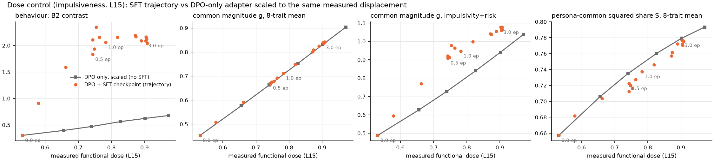

# Persona-common trajectory — preliminary, impulsiveness only (existing data)

**2026-10-15 · branch `exp/common-trajectory` · spec [docs/spec_common_trajectory.md](../../spec_common_trajectory.md).**
This answers brief §2 before any loving or misalignment training was read: is the proposed
analysis feasible from existing data, and are extra controls needed? It used CPU only and no
re-extraction. All numbers are at L15 (primary), with L20 in the JSON.

## Feasibility: yes, fully, from cache

- **Activations.** All 18 native sequential states are cached at L15 and L20: DPO-only, 16
  intermediate checkpoints and the 3-epoch endpoint. Each is (8 traits × 12 personas × 500
  questions), with identical question sets across states.
- **Behaviour.** All 18 states have complete forced-choice logits, 88 cells each.
- **Reuse is verified, not assumed.**
  - Recomputed functional dose matches the paper's `figA_oct_sft_curve.csv` at all 18 states.
  - `behaviour.py` reproduces the paper's B1 at every checkpoint (+0.132 … +2.197).
  - `geometry.py` asserts that its point estimates equal `common_shift.stats_for_trait`. Its
    values and CIs match the stored `common_shift_oct_stage.json`, e.g. impulsivity
    g(final) 1.102 [0.957, 1.361].
- **One established output was found stale.** `outputs/analysis/functional_dose.json` no longer
  holds the curve arms at L15. A later run overwrote that layer with three arms. This is why
  dose was recomputed into a new file. The paper's CSV is unaffected.

## Result

| | DPO-only | 0.48 ep | 1.00 ep | 3.00 ep |
|---|---|---|---|---|
| B2 (log-odds) | +0.30 | +1.83 | +2.06 | +2.09 |
| behaviour F(B2), fraction of SFT-induced change | 0 | **0.86** [0.85, 0.87] | 0.98 | 1 |
| common magnitude g, 8-trait mean, fraction of change | 0 | **0.56** | 0.67 | 1 |
| Q, projection on the final SFT common shift, 8-trait | — | 0.64 | 0.74 | 1 |
| cos(dG(e), dG(3)), 8-trait mean | 0.73 | 0.95 [0.95, 0.96] | 0.98 | 1 |
| persona-common squared share S, 8-trait mean | 0.657 [0.638, 0.669] | 0.722 | 0.737 | 0.777 [0.768, 0.783] |
| incremental SFT share S^S, 8-trait mean | — | 0.703 | 0.722 | 0.778 |
| functional dose | 0.531 | 0.743 | 0.782 | 0.903 |

Read against epoch, the two do develop at different rates:
- **Behaviour is essentially saturated by half an epoch.**
- **The common shift's direction also arrives early.** Its cosine with the final direction is
  0.95 at 0.48 epochs.
- **Its magnitude and projection keep growing to three epochs.** They are only 56–64 % of the
  way at 0.48 epochs.

DPO already installs a substantially persona-common shift (S = 0.66). SFT's own increment is
*at least as* persona-common (S^S 0.70–0.78), so SFT adds common structure rather than
persona-specific structure on top of DPO.

## The control that changes the reading: functional dose

Along the trajectory, measured dose rises 0.53 → 0.90. The existing DPO-only ladder (the DPO
adapter scaled 1.36–2.5×, no SFT, from `DOSE_MATCHED_STAGE_REPORT.md`) covers dose 0.53–0.97.
So every checkpoint can be compared with "just more DPO" at the same displacement, using the
same estimator (`scripts/common_trajectory/control_dose.py`).

| trajectory minus DPO-only, at matched dose | L15 | L20 |
|---|---|---|
| common magnitude g, 8-trait mean | **+0.004** (range 0.000 – 0.008) | +0.013 |
| persona-common share S, 8-trait mean | **−0.009** (−0.023 – +0.006) | +0.005 |
| common magnitude g, impulsivity + risk-taking | +0.140 (up to +0.232) | +0.342 |
| share S, impulsivity + risk-taking | +0.034 | +0.105 |
| B2 behaviour | **+1.38** (up to +1.86) | — |

- **Averaged over traits, the persona-common geometry is a function of displacement alone.**
  A DPO-only model pushed to the same dose has the same common magnitude and the same common
  share. The "slow" common-shift trajectory is the dose trajectory. SFT keeps moving the model
  after the phenotype has saturated (0.74 → 0.90), and the common shift grows with it.
- **This is partly arithmetic, and the write-up must say so.** For a stable share S,
  g ≈ √S × (rms per-persona displacement / base norm), and the dose is essentially that
  displacement. So the 8-trait g is close to a re-expression of dose. **The informative
  quantities are S and the distribution of the common shift across traits**, not g alone.
  Neither S nor the 8-trait g departs from the DPO-only line.
- **SFT does change *where* the common shift goes.** At matched dose, the impulsivity and
  risk-taking common shift is larger along the trajectory than for scaled DPO (g +0.14 at L15,
  +0.34 at L20). Its share is slightly higher too. This is the known selectivity result
  (`SFT_CURVE_REPORT.md`), now located in the persona-common component. It is small next to
  the behavioural gap at matched dose (B2 +1.38).

## Implications for the loving / misalignment arms (no change to the frozen spec)

1. **Report every geometric trajectory against dose, with the DPO-only scaled ladder as the
   reference.** Epoch alone confounds "the common shift develops slowly" with "the model keeps
   being displaced". For loving and misalignment this needs a small DPO-only ladder: about 4
   scaled states each, with the same measurement as the trajectory, roughly 2.3 GPU hours per
   constitution. **This is the additional control the brief asked us to identify.** It is
   recorded here and has **not** been added to the frozen spec's run list. It is a
   measurement-only addition (no training) that can follow the trajectory measurement.
2. **Lead with S and the trait composition, not g.**
3. **No claim from adjacent checkpoints.** The scatter documented in `SFT_CURVE_REPORT.md`
   applies here: B2 moves ±0.2–0.45 between checkpoints 15 steps apart.

## Limits

- One seed, one constitution, one base model.
- The question-bootstrap CIs are evaluation-only.
- The curve-vs-ladder comparison uses two independent bootstrap runs, so the gap has no paired
  interval. Its size, at most 0.008 for the 8-trait g, makes that moot for the null result.
- The excess for the target traits is a point comparison.

## Files

| path | |
|---|---|
| `outputs/analysis/common_trajectory/behaviour_impulsiveness.json` | 8 offsets, B1, B2, changes and fractions with paired CIs, 18 states |
| `outputs/analysis/common_trajectory/geometry_impulsiveness.json` (+ `geometry_boot_*.npz`) | g, S, energies, cos, S^S, Q per trait, 8-trait mean and targets, L15 and L20 |
| `outputs/analysis/common_trajectory/functional_dose_impulsiveness{,_dpo_ladder}.json` | dose, new files |
| `outputs/analysis/common_trajectory/common_shift_impulsiveness_dpo_ladder.json` | ladder geometry |
| `outputs/analysis/common_trajectory/{fig_trajectory,fig_trajectory_dose,fig_control_dose}.png`, `table_trajectory.csv`, `trajectory_points.csv`, `control_dose.json` | figures and tables |
| `scripts/common_trajectory/{states,behaviour,geometry,figures,control_dose}.py` | code |
