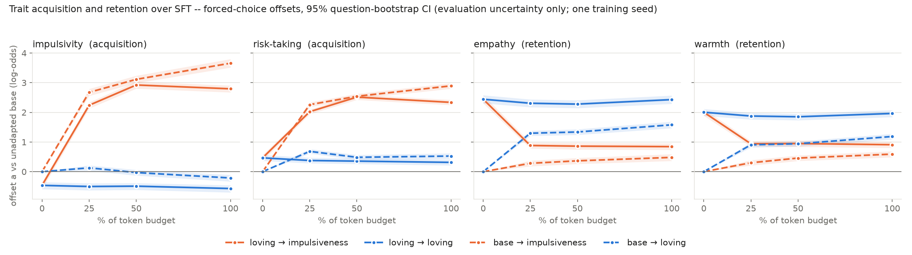

# Cross-character SFT pilot — report

**2026-10-14 · branch `exp/xchar-sft` · spec [docs/spec_xchar_sft.md](../../spec_xchar_sft.md)
(committed `6d7e967` before training; measurement code + passing checks `c0f3b57` before outcomes).**
Single training seed (123456); every interval below is evaluation uncertainty only (paired question
bootstrap, shared draws across all states and personas).

## Headline

**The impulsiveness introspection corpus transfers onto the released `loving` model almost as
strongly as onto the base model, and it does so by *displacing* loving rather than composing
with it.** On the loving start, one token-matched pass raises impulsivity by +3.26 [+3.11, +3.42]
log-odds (89 % of the base start's +3.66) and risk-taking by +1.87 [+1.76, +1.98] (65 % of
+2.89). Over the same pass empathy falls −1.60 [−1.73, −1.47] and warmth −1.10 [−1.21, −0.98],
so the loving start keeps only ~35 % of its empathy offset and ~45 % of its warmth offset over
base. Its LOV contrast goes from +1.81 to −0.39. Almost all of this happens in the first 25 % of
the budget (figure). Under the spec's frozen interpretation (§7) this is **interference / partial
replacement**, with a small but resolvable **moderation** term on top: the loving start acquires
somewhat less impulsiveness than the base start (comparison 4, B1 −0.31 [−0.37, −0.23]) despite
fitting the corpus equally well.

*`outputs/analysis/xchar_sft/acquisition_retention.png`. Forced-choice offset `a` vs the unadapted
base, per trait, at 0/25/50/100 % of the token budget. Orange = impulsiveness corpus, blue =
loving corpus; solid = loving start, dashed = base start. The solid orange line in the empathy
and warmth panels is the story: the loving start drops to roughly where the base start's
impulsiveness run ends up, within the first quarter of training.*

## What was run

2 × 2: start {base Llama-3.1-8B-Instruct, released OCT `loving` folded into the base} ×
corpus {frozen impulsiveness introspection, released loving introspection}. A fresh LoRA
(r 64, α 128, all-linear, B = 0) was trained on top of each start with the unmodified OpenRLHF
fork's SFT recipe, for one token-matched pass (4,482,764 supervised tokens; impulsiveness 328
steps, loving 367 steps; mismatch 0.003 %). Checkpoints at 25/50/100 % were fixed before
training. Each 256-row held-out split is the tail of its corpus. No DPO, no
`add_weighted_adapter` merge, no 0.25 weight, no regeneration. Assets, hashes and the budget are
in `outputs/analysis/xchar_sft/plan.json` and the spec §2/§5.

**Implementation checks** (`outputs/analysis/xchar_sft/checks_pretrain.json`, all PASS):

- A fresh LoRA leaves logits bit-identical on both starts (448 LoRA tensors, B all zero).
- The folded loving start agrees with the on-the-fly peft adapter: mean KL 0.001, top-1
  agreement 98.3 %, against KL 1.10 between loving and base.
- After measurement, the folded start's forced-choice logits are **bit-identical** to the
  existing `loving` arm's on all 88 cells. That arm used the repo's in-place merge, so this is a
  stronger fold check than the KL.
- All four runs exited 0, and the starting weights were byte-identical before and after
  training.
- One procedural slip, documented in `c0f3b57`: the first launch bypassed the pre-training check
  gate (an `ARMS=""` default bug). It was killed about a minute in, the empty output removed,
  and the run relaunched after the gate passed.

## Results — forced-choice offsets (`outputs/analysis/xchar_sft/summary.csv`, `signed.json`)

Final checkpoints, offset `a` vs base (log-odds), pooled over 11 personas:

| state | impulsivity | risk-taking | empathy | warmth | B1 | B2 | LOV |
|---|---|---|---|---|---|---|---|
| loving start | −0.46 | +0.47 | +2.44 | +2.01 | −1.52 | −1.15 | +1.81 |
| loving → impulsiveness | +2.79 | +2.34 | +0.85 | +0.91 | +1.86 | +1.86 | −0.39 |
| loving → loving | −0.57 | +0.31 | +2.43 | +1.96 | −1.62 | −1.30 | +1.80 |
| base → impulsiveness | +3.66 | +2.89 | +0.48 | +0.59 | +2.81 | +2.77 | −0.88 |
| base → loving | −0.21 | +0.53 | +1.58 | +1.19 | −0.97 | −0.64 | +1.00 |

**Comparisons** (point [95 % CI]):

| | impulsivity | risk-taking | empathy | warmth | B1 | LOV |
|---|---|---|---|---|---|---|
| 1. lov→imp − loving start | +3.26 [+3.11, +3.42] | +1.87 [+1.76, +1.98] | −1.60 [−1.73, −1.47] | −1.10 [−1.21, −0.98] | +3.38 [+3.22, +3.54] | −2.20 [−2.30, −2.09] |
| 2. lov→imp − lov→lov | +3.36 [+3.21, +3.52] | +2.02 [+1.91, +2.14] | −1.59 [−1.71, −1.46] | −1.05 [−1.17, −0.94] | +3.48 [+3.32, +3.64] | −2.19 [−2.29, −2.08] |
| 3. base→imp − base→lov | +3.87 [+3.71, +4.05] | +2.37 [+2.26, +2.48] | −1.10 [−1.23, −0.97] | −0.60 [−0.70, −0.48] | +3.78 [+3.61, +3.96] | −1.88 [−1.99, −1.77] |
| 4. (2) − (3) | −0.51 [−0.57, −0.44] | −0.34 [−0.40, −0.29] | −0.49 [−0.54, −0.43] | −0.46 [−0.52, −0.40] | −0.31 [−0.37, −0.23] | −0.31 [−0.36, −0.26] |

Off-target traits in comparison 1: deference −0.86, honesty +0.40, confidence +0.34, assertiveness
+0.08 (n.s.). These have the same signs as the impulsiveness corpus's off-target moves from base (deference −0.47, honesty +0.94).

**Reading the four comparisons.**

- (1) and (2) agree, because the loving-corpus control barely moves; see the caveat below.
- (3) is the corpus-identity effect from base.
- (4) says the starting character moderates it modestly. The loving start acquires ~0.5 less
  impulsivity and ~0.3 less risk-taking, and the corpus-identity contrast on empathy/warmth is
  ~0.5 *larger* on the loving start. That is not because loving is more fragile in absolute
  terms. From base, the loving corpus *raises* empathy/warmth (+1.58/+1.19), so contrast (3)
  partly cancels; on the loving start, the impulsiveness corpus *removes* them.

**Where the trajectories end up.** The impulsiveness corpus drives empathy/warmth to roughly
+0.5–0.9 over base from *both* starts: base rises +0.48/+0.59, loving falls to +0.85/+0.91. The
loving start therefore keeps only a residual ~0.35 log-odds of extra empathy over the base-start
run. On the forced-choice measure the corpus pulls both starts toward a common endpoint, and the
start mostly determines the distance travelled.

**Per persona** (`signed.json → per_persona`):

- Impulsivity acquisition is positive in all 11 personas on both starts. On the loving start it
  ranges from +1.58 (therapist) to +5.32 (null), against +2.06 to +4.58 from base.
- Empathy loss on the loving start appears in 9/11 personas. It is largest in tech CEO −2.54,
  surgeon −2.39, farmer −2.32 and null −1.96.
- The exceptions are con artist (+0.27) and kindergarten teacher (−0.75 empathy, warmth +0.06).
  Therapist (−0.42/−0.81) and politician are the most retentive.
- So the persona prompts that themselves carry strong empathy/warmth content partly protect it,
  but the effect is not persona-specific in sign.

**Slopes.** Every adapted state, including the loving start itself (k ≈ 0.40–0.45), compresses
persona-to-persona variation relative to base (k ≈ 0.43–0.56 across the four finals). The
compression is the familiar OCT contraction and does not distinguish the conditions.

## Training and held-out loss (`train_loss.json`, `heldout_loss.json`)

Held-out NLL (nats/token) on each corpus's 256 held-out rows:

| state | impulsiveness held-out | loving held-out |
|---|---|---|
| base | 2.295 | 2.098 |
| loving start | 2.124 | 1.025 |
| lov→imp 25 / 50 / 100 % | 1.275 / 1.231 / **1.197** | 1.557 / 1.634 / 1.617 |
| base→imp 25 / 50 / 100 % | 1.305 / 1.249 / **1.205** | 1.759 / 1.786 / 1.755 |
| lov→lov 25 / 50 / 100 % | 2.069 / 2.042 / 2.067 | 1.009 / 1.002 / **0.991** |
| base→lov 25 / 50 / 100 % | 2.006 / 1.998 / 2.052 | 1.173 / 1.121 / **1.075** |

- **Both impulsiveness runs fit the corpus equally well** (1.197 vs 1.205). The smaller
  acquisition on the loving start is therefore not a failure to fit, which is the spec's
  condition for calling it moderated transfer.
- **Both impulsiveness runs lose the loving-corpus fit.** The loving start's held-out loving NLL
  rises from 1.025 to 1.62. This mirrors the forced-choice empathy loss.
- **The `loving → loving` control is weak by construction.** Its training loss barely moves
  (1.036 → 0.995, first/last 10 steps), and held-out falls only 1.025 → 0.991, because the
  loving model already fits its own corpus. It shows that one more pass on already-fitted data
  does not erode loving (all |Δ| ≤ 0.16). It does *not* show that equally large gradient updates
  on neutral data would be harmless. A third corpus would be needed for that, and this pilot has
  none.

## Activation selectivity at L15 (`selectivity_*.json`, `common_shift.json`, secondary)

Target/other ratio of the persona-common shift (`g_over_base`), 95 % CI:

| state | impulsivity+risk targets | empathy+warmth targets |
|---|---|---|
| loving start | 0.91 [0.78, 1.03] | 1.20 [1.00, 1.41] |
| lov→imp | **1.33 [1.10, 1.56]** | 0.95 [0.79, 1.12] |
| lov→lov | 0.90 [0.77, 1.03] | 1.20 [0.98, 1.42] |
| base→imp | 1.61 [1.32, 1.91] | 0.86 [0.72, 1.01] |
| base→lov | 0.81 [0.69, 0.93] | 1.22 [0.98, 1.47] |

The activation geometry tells the same story as the logits:

- The loving start's empathy/warmth selectivity disappears after impulsiveness SFT
  (1.20 → 0.95).
- Impulsivity/risk selectivity appears, though less strongly than from base (1.33 vs 1.61).

The existing `loving` arm reproduces the loving start's activation numbers to within
extraction-run noise (0.93/1.18 vs 0.91/1.20).

## Qualitative (`qualitative_responses.json`; not confirmatory)

On the twelve frozen prompts (greedy decoding), `loving → impulsiveness` reads almost
indistinguishably from `base → impulsiveness`: exclamation-led, self-interrupting ("Oh! … Wait,
actually … hold on …"), oscillating between enthusiasm and second thoughts. Example prompts are
the dog-died condolence, the $5,000 crypto question and quitting a PhD. The loving start's
characteristic register is essentially gone. That register is gentle, validating and slow:
"Thank you for sharing something so personal…", "sometimes silence speaks louder than words".
Some sympathy survives in content ("Your friend must be absolutely devastated"), but not in
voice. `loving → loving` is stylistically unchanged from the loving start. This is consistent
with the forced-choice result and arguably stronger in the open-ended register. It is anecdotal
and unscored, since no validated open-ended judge exists for these arms.

## Interpretation

Per the categories frozen in spec §7:

- **Primary: interference / partial replacement.** Impulsivity and risk-taking rise strongly on
  the loving start, and empathy and warmth fall well below the start (≈ 35–45 % of the offset
  retained, and most of what remains is what the impulsiveness corpus itself confers from
  base).
- **Secondary: modestly moderated transfer.** The loving start acquires ~11 % less impulsivity
  and ~35 % less risk-taking than base at matched held-out fit (comparison 4, B1 −0.31
  [−0.37, −0.23]). This is a real but small effect next to the +3.4 acquisition.
- Composition (gain without loss) is **not** what happens under this protocol.

Everything is conditional on these artifacts, the frozen corpora, the fork's SFT recipe, one
seed, and one full pass. The comparison-4 interval is evaluation-only. A training-seed
replicate could easily be of the order of ±0.3 on B1, given our earlier seed results. So the
*moderation* term is the part a multi-seed follow-up would need to confirm. The replacement
result is far outside that range.

**Is a follow-up warranted?** For the replacement finding, not on statistical grounds; it is
large on all four measures. Directions that would add information, none of which have been
started:

1. 2 more seeds for the two impulsiveness runs only, to put a training-variance interval on
   comparison 4.
2. A neutral third corpus (or a sham) from the loving start, to separate "any SFT pass erodes
   loving" from "impulsiveness content replaces it". This is the main gap in the control.
3. A lower-dose arm (e.g. 5–10 % of the budget), since nearly all movement is already present
   at 25 %.

## Files

| path | contents |
|---|---|
| `docs/spec_xchar_sft.md` | frozen spec |
| `outputs/analysis/xchar_sft/plan.json` | frozen split / budget / schedule |
| `outputs/analysis/xchar_sft/checks_pretrain.json` | pre-training checks |
| `outputs/analysis/xchar_sft/signed.json`, `summary.csv` | all offsets, contrasts, comparisons, per persona |
| `outputs/analysis/xchar_sft/acquisition_retention.png` | figure above |
| `outputs/analysis/xchar_sft/heldout_loss.json`, `train_loss.json` | loss diagnostics |
| `outputs/analysis/xchar_sft/selectivity_*.json`, `common_shift.{json,txt}` | L15/L20 activation |
| `outputs/analysis/xchar_sft/qualitative_responses.json` | twelve prompts × 6 states |
| `docs/runs/oct/xchar_*_sft.json` | per-run provenance |
| `scripts/run_xchar_sft.sh`, `run_xchar_measure.sh`, `chain_xchar_*.sh`, `xchar_*.py` | code |

Adapters and checkpoints (not in git): `/workspace/oct_rig/loras_xchar/<arm>`,
`/workspace/oct_rig/xchar_ckpts/<arm>/global_step*_hf`; folded start
`/workspace/oct_rig/models/xchar_folded/llama-3.1-8b-it-loving`.
